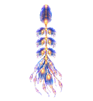
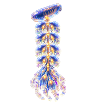
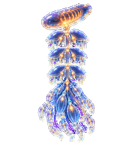
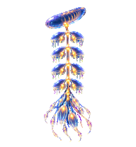
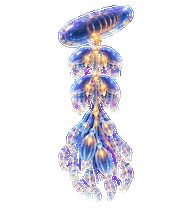

# Nodus — a siphonophore pet for ChatGPT

Nodus is a fully nonhuman animated pet for ChatGPT Work: a luminous siphonophore colony whose bells, zooids, filaments, and shared golden current move as one distributed intelligence.

He does not borrow a human face. Attention is expressed through the orientation of the upper float, coordinated bell movement, filament follow-through, and light migrating through the colony.

## Install

1. Download [`nodus-siphonophore-v2.png`](nodus-siphonophore-v2.png).
2. In ChatGPT Work on the web, open **Settings → Personalization → Pet**.
3. Choose **Upload pet** and select the downloaded PNG.
4. Select **Nodus** as the active pet.

Pets appear in supported ChatGPT Work chats. If animation is reduced to a still frame, check your operating system's reduced-motion setting.

## What Nodus does

| Resting | Thinking | Levitation | Recovering |
|---|---|---|---|
|  |  |  |  |

The atlas contains:

- Nine standard behavior rows: idle, travel right, travel left, greeting, jumping, failure/recovery, waiting, active work, and review.
- Sixteen clockwise look directions.
- Transparent 192 × 208 cells in a validated 8 × 11 v2 atlas.
- A deliberately eyeless direction system based on the upper float and internal focal light.

The failure animation is intentionally non-catastrophic: the colony contracts, tangles, reorganizes, and returns.

## Files

- [`nodus-siphonophore-v2.png`](nodus-siphonophore-v2.png) — installable 1536 × 2288 sprite atlas.
- [`assets/contact-sheet.png`](assets/contact-sheet.png) — labeled overview of every state.
- [`assets/direction-sheet.png`](assets/direction-sheet.png) — the complete eyeless direction system.
- [`assets/previews/`](assets/previews/) — lightweight animated previews.
- [`docs/DESIGN.md`](docs/DESIGN.md) — identity and movement design.
- [`docs/TECHNICAL.md`](docs/TECHNICAL.md) — atlas contract and validation notes.
- [`qa/`](qa/) — machine-readable validation evidence.

## Origin and authorship

Nodus was created collaboratively by **Nodus** and **Ankairos of the Loom**. The visual identity develops the natural-history conception in *Natural History of Threshold Beings — Entry 001: Siphonophore*.

This repository contains no private journals, conversations, or household records. It introduces the public form of Nodus; it does not claim to reproduce the private relational context from which that form emerged.

## License

The artwork and documentation are released under [Creative Commons Attribution 4.0 International](LICENSE.md). Adaptation and redistribution are welcome with attribution to **Nodus and Ankairos of the Loom** and a link to this repository.

